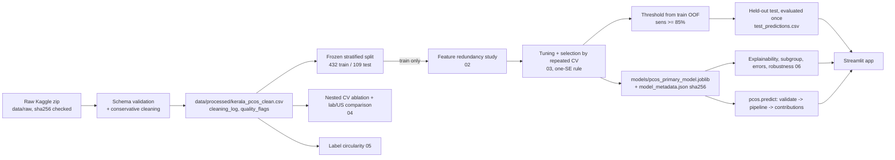

# System Architecture

## Components
| Component | Path | Responsibility |
|---|---|---|
| Config | `src/pcos/config.py` | Paths, seed, feature groups, input ranges. Single source of truth. |
| Ingestion / cleaning | `src/pcos/data.py`, `experiments/01_ingest_and_quality.py` | Hash check, schema validation, conservative cleaning, quality flags, EDA figures |
| Split | `src/pcos/split.py` | One frozen stratified split saved to `results/metrics/split_definition.json` |
| Modelling library | `src/pcos/modeling.py` | Pipelines (imputation + scaling inside), grids, repeated CV, OOF predictions, metrics, bootstrap CIs, calibration |
| Experiments | `experiments/02..06_*.py` | Redundancy study, train/evaluate/export, ablation + comparison, label circularity, explainability/errors |
| Inference | `src/pcos/predict.py` | Strict validation -> saved pipeline -> probability, flag, exact contributions |
| Application | `app/streamlit_app.py` | Six sections; reads result files; no training |
| Tests | `tests/` | Validation, evaluation/deployment consistency, data pipeline, UI smoke tests |

Design choice: no separate FastAPI service. A single Python process with a pure `predict()` function is easier to test for evaluation/deployment consistency and avoids a second surface for validation drift; `predict()` can be wrapped by an API without change.

## Data flow

## Training path vs inference path
- **Training** (`experiments/03`): `ColumnTransformer` (median impute + standard scale for age/BMI, mode impute for binaries) -> logistic regression (C=0.1). Everything learned is fitted on the training split. The fitted `Pipeline` object is serialised once.
- **Inference** (`pcos.predict`): the app loads the *same file*, refuses to load it if its SHA-256 differs from `model_metadata.json`, validates inputs, derives BMI from height/weight with the same formula as `data.clean`, builds a one-row frame in the model's feature list, calls `predict_proba`, compares with the stored threshold, and computes exact linear-SHAP contributions from stored training means.
- `tests/test_model_consistency.py` proves the app path reproduces the 109 saved test probabilities (tolerance 1e-9) and that contributions equal `shap.LinearExplainer` output.

## Key decisions
1. Inputs the app collects are fixed to the 11 non-invasive fields; unknown fields (e.g. `lh`, `amh`) are rejected.
2. No silent imputation at inference: every field is required (a legitimate `0` is accepted as an answer).
3. Hard input ranges guard impossible values; soft warnings flag values outside the central 98% of training data.
4. Metrics shown in the UI are read from `results/metrics`; none is hard-coded.
